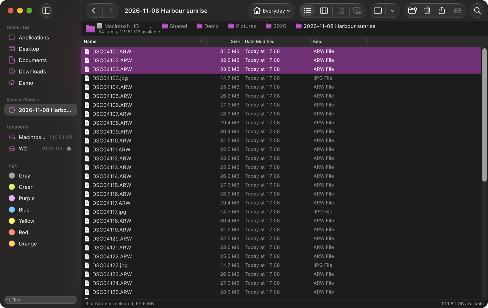
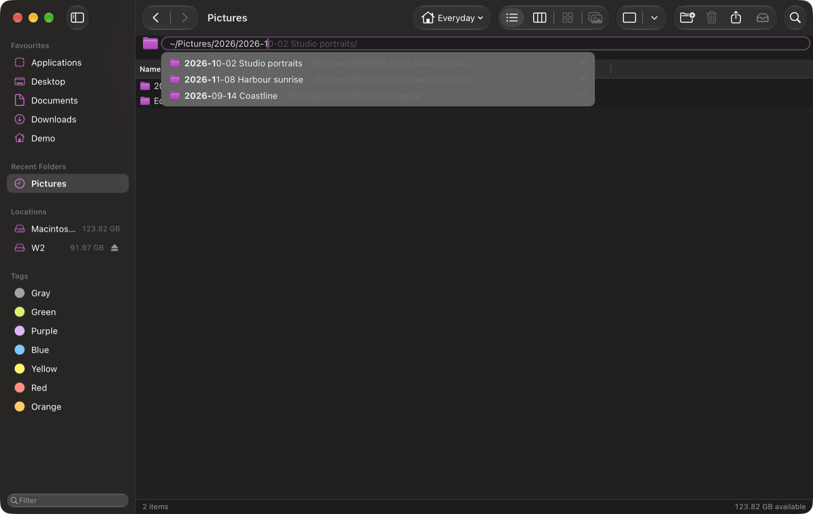
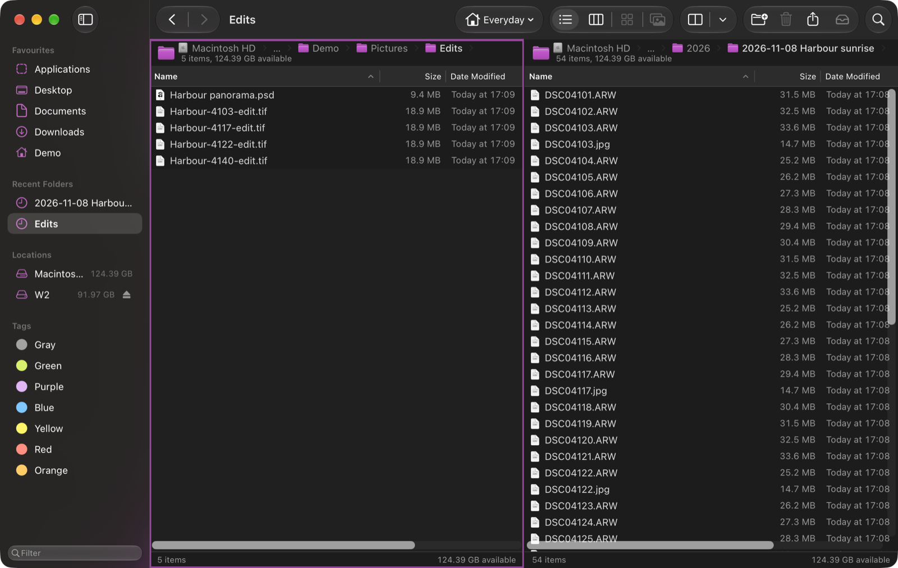
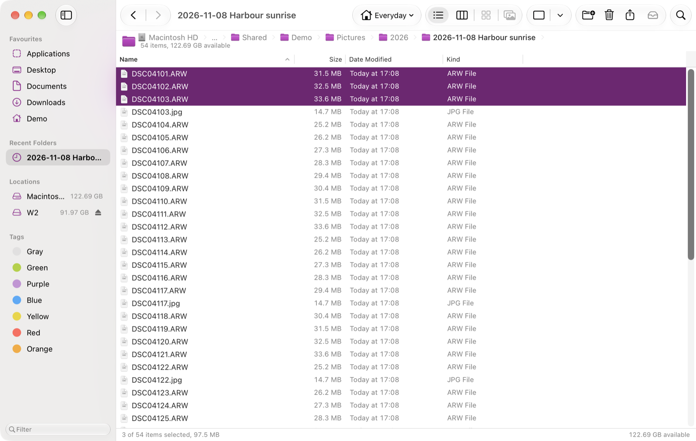

# File Studio

[](https://github.com/chxdr/file-studio/actions/workflows/ci.yml)


A fast, Mac-native file manager for power users: the depth of Directory Opus with the feel of an Apple app.

File Studio has a Rust core that owns every behaviour, plus a thin native shell for each platform. The macOS shell is AppKit and SwiftUI. Linux and Windows shells come later.



> **Status:** early and moving fast. Milestone 2, the first usable Mac app, is signed off. Safe Transfer, the copy engine that survives a pulled card, is being connected to the app now. There are no releases yet: build it from source (below).

## Why another file manager

- **Fast.** The core lists and sorts in Rust, and a 100,000-file folder scrolls smoothly.
- **Keyboard first.** Every action is a command with a shortcut. Hold ⌘ to see the shortcuts, and switch between the Standard and Vim keymaps.
- **Never loses your files.** Copies are verified, nothing is ever silently overwritten, and deleting always goes to the Trash. Permanently deleting is a separate action, and it's off unless you turn it on.
- **Looks like it belongs on a Mac.** It uses native controls, the system's glass and vibrancy, and light and dark mode.

## Features

### An address bar that's both a breadcrumb and a text field

Click a folder name to jump to it, or press ⌘L and type. Completion understands fuzzy matches and the folders you use most.



### Dual pane, tabs and workspaces

Work side by side in two panes, each with its own tabs. Workspaces keep separate sets of tabs and layouts, such as "Everyday" and "Photo work", and you switch between them with ⌃⌘1 to ⌃⌘9.



### Light and dark



### Also in the box

- List and column views, with type-to-select and filter-as-you-type
- A sidebar with favourites you can pin and reorder, recent folders, volumes with eject, and tags
- Quick Look, drag and drop with Finder, and context menus
- An operations queue with pause, resume and cancel, a clear conflict dialog, and undo for every operation
- A first-run setup and a short tour of the power features

## Safety

Data safety is the one thing that isn't negotiable. These rules live in the Rust core and are covered by tests:

- **Nothing is silently overwritten.** Every write goes to a temporary file first and only takes the real name, without replacing anything, once it's complete and flushed to disk.
- **Nothing is hard-deleted** except through one separate "Delete Immediately" action, which is off by default. Everything else goes to the Trash and can be put back.
- **Moves between disks** remove the original only after the copy has been verified.
- **No silent moves.** Dragging in the sidebar only reorders shortcuts. Moving a standard folder like Documents asks first. Every move shows a toast with Undo.
- **Errors are reported per file.** One bad file doesn't stop the rest of the operation.
- **iCloud placeholders** are never downloaded unless you ask.

### Safe Transfer

Safe Transfer is the copy engine for cards and external drives. It is built so that pulling a card, losing power or crashing never leaves a half-written file that looks complete:

- It writes without the cache and checksums each chunk.
- It flushes to the physical disk, then reads the copy back from the disk and compares.
- It keeps a journal on the Mac, so an interrupted copy resumes where it stopped, even after the card was plugged into another port.

The test suite really does pull the drive: it force-detaches disk images in the middle of copies and checks every file afterwards. You can read about it in [`docs/SAFE-TRANSFER-PROPOSAL.md`](docs/SAFE-TRANSFER-PROPOSAL.md).

## Building from source

You need an Apple silicon Mac with macOS 26 or later, Xcode, [Rust](https://rustup.rs) and [XcodeGen](https://github.com/yonaskolb/XcodeGen).

```bash
git clone https://github.com/chxdr/file-studio.git
cd file-studio/apple
xcodegen
xcodebuild -project FileStudio.xcodeproj -scheme "File Studio" -configuration Release -derivedDataPath build/dd build
open "build/dd/Build/Products/Release/File Studio.app"
```

Debug builds are a separate app, called "File Studio Debug", with their own settings, so experimenting never touches your everyday setup.

To run the core's tests:

```bash
cargo test --workspace
```

## How it's built

| Part | What it does |
|---|---|
| `crates/fstudio-core` | The app's brain: commands, settings, menus and events |
| `crates/fstudio-fs`, `fstudio-view` | Listing folders, sorting, filtering and watching for changes |
| `crates/fstudio-ops` | The operations queue, its journal, undo and the Trash |
| `crates/fstudio-path` | Address bar parsing and completion |
| `crates/fstudio-keymap` | Commands, shortcuts and keymaps |
| `crates/safe-transfer` | The verified, resumable copy engine |
| `crates/fstudio-ffi` | The bridge to Swift (UniFFI) |
| `apple/` | The macOS app. It draws and forwards input, and holds no app logic |

Design decisions are recorded in [`DECISIONS.md`](DECISIONS.md), and the architecture is described in [`docs/PROPOSAL.md`](docs/PROPOSAL.md).

## Roadmap

- **Now:** Safe Transfer inside the app, with resume after a pulled card
- **Milestone 3:** search, a preview panel and batch rename tools
- **Next:** Connect to Server (SMB) for browsing other computers' drives, and favourites per workspace
- **Later:** SFTP, WebDAV and S3, and the Linux and Windows shells

## Licence

File Studio is free software, released under the [GNU General Public License v3.0 or later](LICENSE).
